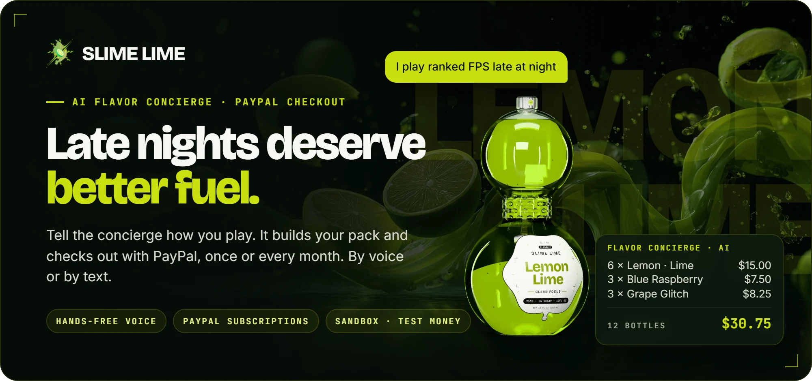
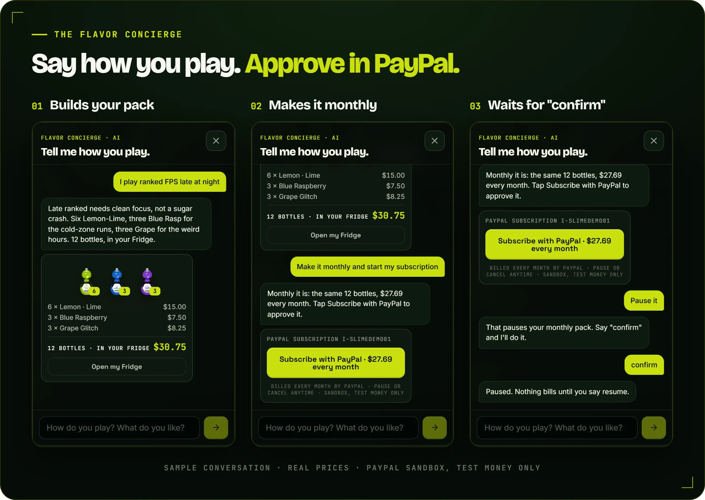
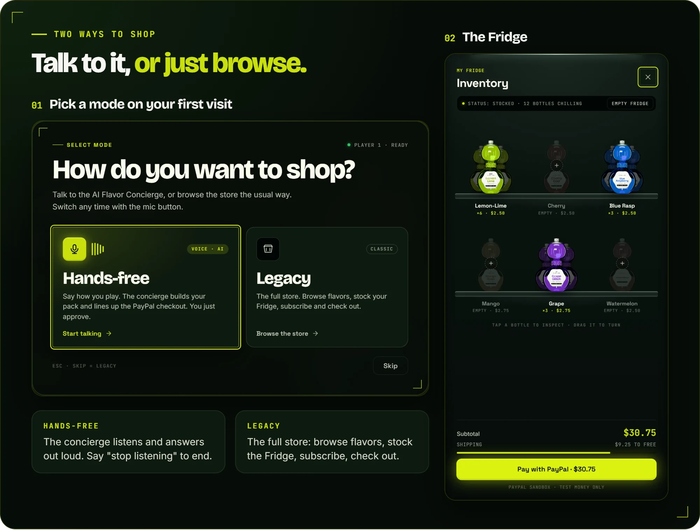
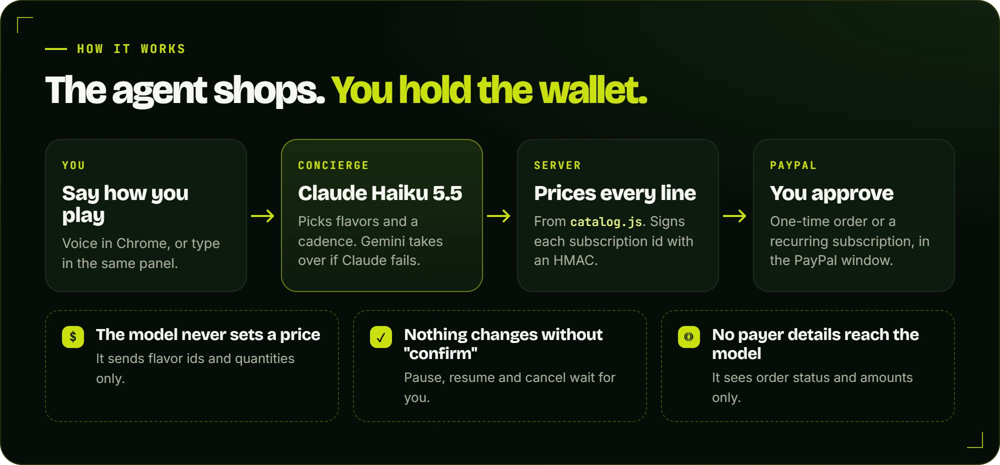

<p align="center">
  
</p>

<p align="center">
  <a href="https://slime-lime-eta.vercel.app"><b>Live site</b></a>&nbsp;&nbsp;·&nbsp;&nbsp;<a href="#try-it">Try it</a>&nbsp;&nbsp;·&nbsp;&nbsp;<a href="docs/demo-script.md">Demo script</a>&nbsp;&nbsp;·&nbsp;&nbsp;<a href="#how-it-works">How it works</a>&nbsp;&nbsp;·&nbsp;&nbsp;<a href="#built-for-the-hackathon">Built for the hackathon</a>
</p>

# Slime Lime

Slime Lime is a fictional clean-formula gaming soda brand, and this repo is its storefront. The hackathon entry is the **Flavor Concierge**: an AI agent that builds your pack from the real lineup, sets a delivery cadence, and checks out with PayPal, either as a one-time order or as a PayPal Subscription. It runs on Claude Haiku 5.5, with Gemini as an automatic fallback, and has a hands-free voice mode.

> [!NOTE]
> Payments run in the **PayPal sandbox, test money only**. Nothing is charged and nothing ships.

<p align="center">
  
</p>

## Try it

1. Open https://slime-lime-eta.vercel.app. On your first visit a mode picker asks how you want to shop: pick **Legacy** (or **Skip**) to type, or **Hands-free** to talk (see below).
2. Click **Flavor Concierge** (bottom right) and say how you play, for example: *"Late-night ranked, nothing too sweet, 12 bottles."*
3. The agent builds a pack and drops it into the Fridge (the cart). Say *"yes, check out"*.
4. Approve the payment with the PayPal button in the chat, using a PayPal sandbox buyer account. The agent then confirms the order with PayPal.
5. Open the concierge again and say *"get my usual"* to reload your last order.
6. Or say *"make it monthly and start my subscription"* and tap **Subscribe with PayPal**. Later, *"what's my subscription?"*, *"pause it"* and then *"confirm"*: the agent changes nothing until you confirm.

<p align="center">
  
</p>

**Hands-free mode.** Pick **Hands-free** in the mode picker, or tap the mic button in the nav at any time, to switch. The concierge opens full screen, keeps listening (no wake word) and answers out loud. Say *"confirm"* to approve a pause, resume or cancel, and *"stop listening"* to turn the mic off. Payment is never approved by voice: you still tap the PayPal button. Voice needs Chrome; in other browsers you type in the same panel.

You can also skip the agent: add bottles from the lineup, open the **Fridge**, and click **Pay with PayPal**. For a subscription without the agent, build a pack on the **Subscribe** page, click **Add to Fridge**, then **Start subscription** in the Fridge. To clear the cart, click **Empty fridge** in the Fridge (with **Undo** for a few seconds), or tell the concierge *"empty my cart"*.

The full walkthrough, with what to say at each step, is in [`docs/demo-script.md`](docs/demo-script.md).

## How it works

<p align="center">
  
</p>

- **Frontend:** a static, no-build React 18 SPA. `Slime Lime.html` loads React and Babel-standalone from a CDN, compiles the `.jsx` files in the browser, and hash-routes between pages. Vanilla CSS, three.js for the 3D bottle, GSAP for motion.
- **Backend:** Node serverless functions in `api/` on Vercel, for PayPal and the concierge.
- **Prices are always computed on the server.** The browser and the AI model only send flavor ids and quantities. Every amount PayPal charges comes from `api/_lib/catalog.js`, so a tampered cart or a confused model can't change a price.
- **The concierge never sees payer details.** It confirms payment with `get_order` from the PayPal Agent Toolkit, wrapped by `summarizeOrder` in `api/_lib/concierge.js`, which passes back only order status and amounts.
- **"My usual" stays on the device.** The last 5 paid orders (order id, date, flavor ids and quantities, total) and the last 5 approved subscriptions (subscription id, its server signature, cadence, pack) live in `localStorage['sl-orders']`. No accounts, no server database.
- **Public endpoints have abuse limits.** The concierge refuses oversized requests before any model call (32 KB body, 20 messages, 20 pack lines, 5 history entries) and caps each turn at 5 tool steps and 700 output tokens. A Vercel Firewall rule limits the concierge to 10 requests per minute per IP (live since Nov 11, 2026); the current plan allows only one rate-limit rule, so the PayPal endpoints rely on the code caps. [`docs/limits.md`](docs/limits.md) has the exact rules and their status. When the firewall answers 429, the chat shows "Easy there — the concierge needs a breather. Try again in a minute."
- **Subscription plans are auto-provisioned.** The server finds or creates the PayPal catalog product and one billing plan per cadence (biweekly, monthly, quarterly), so nobody copies plan ids into env vars. See [`docs/subscriptions.md`](docs/subscriptions.md).
- **Subscriptions are server-priced and signed.** The server sets each subscription's price itself and hands the browser an HMAC of the subscription id (`api/_lib/subsign.js`). Checking, pausing, resuming and cancelling only work with that signature, and the server re-prices the pack before trusting a subscription, so nobody can start one on the public plan id at a price we never set.
- **Subscription changes need a confirm.** The agent's pause, resume and cancel tools change nothing on their own. They return a pending action, signed by the server, that runs only when the shopper taps **Confirm** or says *"confirm"* within 30 seconds.
- **Hands-free runs in the browser.** `voice.jsx` uses Chrome's speech recognition and speech synthesis, and pauses the mic while the agent talks so it never hears itself. `handsfree-fx.jsx` draws the full-screen stage and the visuals for each agent step.

<details>
<summary><b>Key files</b></summary>

```
Slime Lime.html        entry: loads CDN scripts, mounts <App/>
shell.jsx              FLAVORS data, nav, footer, cart state, PayPal button hook
fridge.jsx             the Fridge (cart) with 3D close-up and PayPal checkout
concierge.jsx          the Flavor Concierge chat panel
mode.jsx               the Hands-free / Legacy mode picker
voice.jsx              hands-free voice loop: listening, spoken replies, voice commands
handsfree-fx.jsx       the full-screen hands-free stage and its visuals
home.jsx, flagship.jsx, subscribe.jsx, story-faq.jsx   pages
bottle3d.js, motion.js, game.js, presence.js           3D bottle, GSAP motion, scroll game, players-online mock
api/_lib/catalog.js    server price list and validation (source of truth for prices)
api/_lib/paypal.js     PayPal OAuth token and REST calls
api/_lib/concierge.js  the agent: system prompt, tools, model selection
api/_lib/plans.js      auto-provisions the PayPal subscription product and plans
api/_lib/subscriptions.js  creates, reads and manages PayPal subscriptions
api/_lib/subsign.js    HMAC signature for subscription ids
api/paypal/            config, orders (create), capture, plans, subscriptions, subscription-manage
api/concierge/chat.js  POST endpoint for the concierge
```

</details>

### Agent tools

| Tool | What it does |
|---|---|
| `build_pack` | Takes flavor ids and quantities, prices them on the server, and fills the Fridge. |
| `start_checkout` | Creates a PayPal Orders v2 order for that pack, server-priced. |
| `reorder_usual` | Reloads a past order from this device's history at today's prices. With an active subscription, it offers an extra one-time pack instead of starting a second subscription. |
| `get_order` | From the PayPal Agent Toolkit. Confirms payment status and answers "where's my order". |
| `set_cadence` | Makes the current pack a subscription (biweekly, monthly or quarterly) and returns the per-delivery total. Starts nothing. |
| `start_subscription` | Creates the PayPal subscription for that pack, server-priced. The shopper approves it with the PayPal button. |
| `subscription_status` | Reads a subscription: status, cadence, amount and next billing date. |
| `pause_subscription`, `resume_subscription`, `cancel_subscription` | Propose a change. Nothing happens until the shopper confirms. |
| `empty_fridge` | Empties the Fridge when the shopper asks ("empty my cart"). A running PayPal subscription is untouched. |

## Run locally

The UI alone needs only a static server:

```bash
python -m http.server 8000
# open http://localhost:8000/Slime%20Lime.html
```

A static server has no `/api`, so checkout shows "Checkout offline" and the concierge can't answer. For the API, use the Vercel CLI:

```bash
npm install
vercel link           # once, to connect to the Vercel project
vercel env pull       # once, writes .env.local with the variables below
vercel dev            # serves the site and /api on http://localhost:3000
```

Then open http://localhost:3000.

## Environment variables

Set these in Vercel (Project, Settings, Environment Variables). Never put them in code.

| Name | Purpose | Required? |
|---|---|---|
| `PAYPAL_CLIENT_ID` | PayPal sandbox app client ID. Also sent to the browser for the JS SDK. | Required |
| `PAYPAL_CLIENT_SECRET` | PayPal sandbox app secret. Server only. | Required |
| `PAYPAL_ENV` | `sandbox` or `live`. Unset means sandbox. | Optional |
| `ANTHROPIC_API_KEY` | Primary concierge model, Claude Haiku 5.5 (`claude-haiku-5-5`). | Required for the concierge, unless the Gemini key is set |
| `GOOGLE_GENERATIVE_AI_API_KEY` | Gemini, used as the fallback when the Claude call fails, or as the main model when no Anthropic key is set. | Optional, recommended |
| `CONCIERGE_MODEL` | Overrides the Claude model id (default `claude-haiku-5-5`). Ignored for Claude unless it starts with `claude-`. | Optional |
| `SUB_SIGNING_SECRET` | HMAC secret that signs subscription ids, so only the browser that started a subscription can check, pause, resume or cancel it. | Required for subscription management |

The concierge picks its model in this order: Claude Haiku 5.5 when `ANTHROPIC_API_KEY` is set, otherwise Gemini when `GOOGLE_GENERATIVE_AI_API_KEY` is set, otherwise the Vercel AI Gateway. When the Claude call fails (credit used up, bad key, rate limit, overload, server error, network or a 25-second timeout) and the Gemini key is set, the turn runs again once on Gemini. Gemini picks up from anything Claude's tools already did, such as a pack it built or a PayPal order it opened, so a retry never opens a second order for the same pack. If both fail at the provider, the panel shows a short message and the server returns 503. Each reply says which model answered (`model`: `anthropic`, `gemini` or `gateway`).

The concierge also accepts `AI_GATEWAY_API_KEY` (Vercel AI Gateway) and `CONCIERGE_GOOGLE_MODEL` (Gemini model id, default `gemini-3.8-flash`). Both are optional. On the Gateway path, `CONCIERGE_MODEL` is used only when it is a Gateway id such as `google/gemini-3-flash`.

## Before merging

Run the price-drift check:

```bash
node scripts/check-prices.mjs
```

Prices live in three places: `api/_lib/catalog.js` (server), `FLAVORS` in `shell.jsx`, and `SUB_CADENCES` in `subscribe.jsx`. The script exits 1 with a diff when they disagree.

## Deploy

Vercel auto-deploys on push to `main`. Production alias: **slime-lime-eta.vercel.app**. Manual deploy: `vercel --prod` from the project root.

## Built for the hackathon

Ready to paste into Devpost: all 45 pull requests merged on or after 2026-10-01, from `gh pr list --state merged --search "merged:>=2026-10-01"`. Dates are merge dates in UTC.

The repo started in April 2026 as a design portfolio piece, before the hackathon.

<details>
<summary><b>All 45 pull requests</b></summary>

| PR | Title | Merged | Summary |
|---|---|---|---|
| [#1](https://github.com/ryanflash66/slime-lime/pull/1) | Revamp unit 7: Story + FAQ responsiveness and accessible accordion | 2026-11-06 | Responsive Story timeline and science grids, and an FAQ accordion with proper ARIA wiring. |
| [#2](https://github.com/ryanflash66/slime-lime/pull/2) | Revamp 1/7 — Foundations: motion tokens, press/hover, reduced motion, responsive type, head perf & meta | 2026-11-06 | Shared easing tokens, button press and hover states, reduced-motion support, responsive type, and faster font loading. |
| [#3](https://github.com/ryanflash66/slime-lime/pull/3) | Revamp unit 5: Flagship PDP: theme lock, responsive, accessible animated tabs | 2026-11-06 | Product page locks to the Lemon-Lime theme, adapts down to phone width, and gets keyboard-accessible tabs. |
| [#4](https://github.com/ryanflash66/slime-lime/pull/4) | Subscribe builder: keep picks on resize, radiogroups, responsive layout, pack-full moment | 2026-11-06 | Changing pack size no longer wipes flavor picks; pack size and cadence become keyboard radiogroups. |
| [#5](https://github.com/ryanflash66/slime-lime/pull/5) | Home sections: responsive grids, accessible lineup, gated motion | 2026-11-06 | Responsive home grids, labelled lineup controls, a pausable live ticker, and motion gated for reduced-motion users. |
| [#6](https://github.com/ryanflash66/slime-lime/pull/6) | Home hero: rAF cursor tracking, gated reticle, offscreen pause, entrance, responsive callouts | 2026-11-06 | Hero cursor effects move to requestAnimationFrame and CSS variables, pause offscreen, and get an entrance animation. |
| [#7](https://github.com/ryanflash66/slime-lime/pull/7) | Revamp unit 2 — Shell: responsive nav, accessible cart drawer, footer form, route titles | 2026-11-06 | Mobile nav menu, accessible cart drawer, a labelled footer email form, and a page title per route. |
| [#8](https://github.com/ryanflash66/slime-lime/pull/8) | Revamp follow-ups: subscription checkout, theme lock in App, Bottle svg width | 2026-11-06 | Subscribe checkout adds subscriber-priced lines with their cadence to the cart; fixes a console error on every page. |
| [#9](https://github.com/ryanflash66/slime-lime/pull/9) | Redesign: real-time 3D double-bubble hero + Midjourney scenes | 2026-11-07 | Real-time three.js bottle in the hero with per-flavor labels and liquid, plus new scene photography across the site. |
| [#10](https://github.com/ryanflash66/slime-lime/pull/10) | Copy: cans → glass bottles | 2026-11-07 | Every mention of cans now says glass bottles, to match the product. |
| [#11](https://github.com/ryanflash66/slime-lime/pull/11) | Perf: compress bottle GLB 2.8 MB → 528 KB | 2026-11-07 | Cuts the 3D bottle download by 81% with WebP textures and meshopt compression. |
| [#12](https://github.com/ryanflash66/slime-lime/pull/12) | Fix: hero stage shows previous flavor's background after resize | 2026-11-07 | Fixes the hero showing the wrong flavor's backdrop after a window resize. |
| [#13](https://github.com/ryanflash66/slime-lime/pull/13) | Typography kit: Al Fresco titles + Glossy Slime hero lettering | 2026-11-07 | Script display titles and glossy hero lettering (fonts later reverted in #16). |
| [#15](https://github.com/ryanflash66/slime-lime/pull/15) | Motion: flavor-switch crossfade, preloading, glossy + splash fade-ins | 2026-11-07 | Smooth crossfade when switching flavors, image preloading, and image fade-ins. Replaces the closed #14. |
| [#16](https://github.com/ryanflash66/slime-lime/pull/16) | Revert to original fonts + real Claude labels on the Midjourney photos | 2026-11-08 | Restores the original fonts and puts the real bottle labels onto the scene photos. |
| [#17](https://github.com/ryanflash66/slime-lime/pull/17) | GSAP motion: page transitions, magnetic hover, card tilt, scroll reveals, scrubbed story | 2026-11-08 | Page-transition curtain, magnetic buttons, card tilt, scroll reveals, and a scroll-scrubbed story. |
| [#19](https://github.com/ryanflash66/slime-lime/pull/19) | Gamified scroll: character select, HUD + XP + levels, achievements, loot flight, Slime Mode | 2026-11-08 | Flavor character select, an XP and level HUD, achievements, bottles that fly into the cart, and a Konami-code Slime Mode. |
| [#20](https://github.com/ryanflash66/slime-lime/pull/20) | Players online + ghost cursors, hero parallax slide, Fridge cart, Subscribe mini game | 2026-11-08 | Mock players-online count with ghost cursors, a parallax flavor slide, the Fridge cart with a 3D close-up, and a "Stock the fridge" mini game. |
| [#21](https://github.com/ryanflash66/slime-lime/pull/21) | Add PR-Agent review and security check | 2026-11-11 | Automatic AI code review with a security section on every pull request. |
| [#18](https://github.com/ryanflash66/slime-lime/pull/18) | PayPal sandbox checkout in the cart | 2026-11-11 | Real PayPal sandbox checkout from the Fridge: server-priced Orders v2 order, JS SDK v6 popup, and capture. |
| [#24](https://github.com/ryanflash66/slime-lime/pull/24) | Demo video script: under-3-minute shot list (DAR-690) | 2026-11-11 | Adds `docs/demo-script.md`, the shot-by-shot script for the demo video. |
| [#26](https://github.com/ryanflash66/slime-lime/pull/26) | README: run steps, env vars, MIT, and Built for the hackathon section | 2026-11-11 | This README: how to run it, environment variables, license and this list. |
| [#27](https://github.com/ryanflash66/slime-lime/pull/27) | Auto-provision PayPal subscription product and cadence plans (DAR-688) | 2026-11-11 | The server finds or creates the PayPal product and one billing plan per cadence, with no plan ids in env vars. |
| [#25](https://github.com/ryanflash66/slime-lime/pull/25) | Replace Twitch/Discord marks with plain icons (no third-party trademarks) | 2026-11-11 | Plain chat and play icons replace third-party logos in the footer and streamer cards. |
| [#28](https://github.com/ryanflash66/slime-lime/pull/28) | Price-drift check script + round subscribe totals like the server (DAR-687) | 2026-11-11 | `scripts/check-prices.mjs` catches price drift between client and server; the Subscribe page now rounds like the server. |
| [#22](https://github.com/ryanflash66/slime-lime/pull/22) | Apply Sourcery review fixes from PR #14 | 2026-11-11 | Code review fixes for the 3D bottle and home page, carried over from the closed #14. |
| [#31](https://github.com/ryanflash66/slime-lime/pull/31) | POST /api/paypal/subscriptions: server-priced PayPal subscription with signed ID (DAR-691) | 2026-11-11 | Creates a server-priced PayPal subscription and returns its id with an HMAC signature. |
| [#29](https://github.com/ryanflash66/slime-lime/pull/29) | Flavor Concierge: AI agent that builds your pack and starts PayPal checkout (rebased on main) | 2026-11-11 | The Flavor Concierge: builds a pack, fills the Fridge, opens PayPal checkout and reloads "my usual". Replaces the closed #23. |
| [#32](https://github.com/ryanflash66/slime-lime/pull/32) | POST /api/paypal/subscription-manage: signed status / pause / resume / cancel (DAR-695) | 2026-11-11 | Status, pause, resume and cancel for a subscription, only with its signature. |
| [#33](https://github.com/ryanflash66/slime-lime/pull/33) | Mode picker overlay + nav toggle: Hands-free vs Legacy (DAR-694) | 2026-11-11 | First-visit picker for Hands-free or Legacy, plus a mic button in the nav to switch. |
| [#34](https://github.com/ryanflash66/slime-lime/pull/34) | Fridge: Start subscription (PayPal recurring) separate from one-time checkout (DAR-696) | 2026-11-11 | The Fridge checks out a subscription pack with PayPal Subscriptions, apart from one-time bottles. |
| [#35](https://github.com/ryanflash66/slime-lime/pull/35) | Concierge on Claude Haiku 5.5 with automatic Gemini fallback (DAR-692) | 2026-11-11 | The concierge runs on Claude Haiku 5.5 and retries once on Gemini if Claude fails. |
| [#36](https://github.com/ryanflash66/slime-lime/pull/36) | Concierge abuse limits: request caps, 700-token turns, 429 breather message (DAR-693) | 2026-11-11 | Request size caps, 700-token turns and a friendly message when the rate limit hits. |
| [#39](https://github.com/ryanflash66/slime-lime/pull/39) | docs: concierge rate limit is live (no IP-wide hold); PayPal rule blocked by plan | 2026-11-11 | Documents the live concierge rate limit in `docs/limits.md`. |
| [#37](https://github.com/ryanflash66/slime-lime/pull/37) | Hands-free voice loop: always-listening mic, spoken replies, voice commands, typed fallback (DAR-697) | 2026-11-11 | Hands-free voice: an always-listening mic, spoken replies, "confirm" and "stop listening", and typing as a fallback. |
| [#38](https://github.com/ryanflash66/slime-lime/pull/38) | Hands-free stage: full-screen look + agent visuals (DAR-698) | 2026-11-11 | A full-screen hands-free stage with visuals for picking flavors, filling the Fridge and checking out. |
| [#40](https://github.com/ryanflash66/slime-lime/pull/40) | Concierge: subscription-aware "get my usual" and "where's my order" (DAR-700) | 2026-11-11 | "Get my usual" and "where's my order" know about an active subscription. |
| [#41](https://github.com/ryanflash66/slime-lime/pull/41) | Concierge: start, check, pause, resume and cancel a PayPal subscription, with confirm (DAR-701, DAR-702) | 2026-11-11 | The concierge starts and manages PayPal subscriptions; every change waits for "confirm". |
| [#42](https://github.com/ryanflash66/slime-lime/pull/42) | docs: concierge rate limit lowered to 10 per minute per IP | 2026-11-11 | Updates the documented rate limit to 10 requests per minute per IP. |
| [#43](https://github.com/ryanflash66/slime-lime/pull/43) | Concierge: PayPal button line only when a button is on screen, plus copy fixes (DAR-708, 709, 713, 714) | 2026-11-11 | The agent mentions the PayPal button only when one is on screen, plus clearer wording. |
| [#44](https://github.com/ryanflash66/slime-lime/pull/44) | Hands-free stage: empty first-visit Fridge, subscription amount, readable agent line (DAR-710, DAR-711, DAR-712) | 2026-11-11 | First visits start with an empty Fridge; the stage shows the subscription amount and always fits the agent's line. |
| [#30](https://github.com/ryanflash66/slime-lime/pull/30) | Remove third-party brand and game names from demo copy (DAR-707) | 2026-11-11 | Site copy no longer names other drinks or games. |
| [#45](https://github.com/ryanflash66/slime-lime/pull/45) | Subscribe page: Add to Fridge, kept in sync with the Fridge; subscription pack shown first | 2026-11-11 | The Subscribe page adds its pack to the Fridge and stays in sync with it; the subscription pack is listed first. |
| [#47](https://github.com/ryanflash66/slime-lime/pull/47) | Empty fridge: a button in the Fridge (with Undo) and an empty_fridge tool for the agent | 2026-11-11 | Empty the Fridge in one click, with Undo, or ask the agent to empty it. |
| [#46](https://github.com/ryanflash66/slime-lime/pull/46) | README: subscriptions and hands-free are live, not in progress | 2026-11-13 | The README describes subscriptions and hands-free mode as shipped. |

</details>

## License

MIT. See [`LICENSE`](LICENSE).
